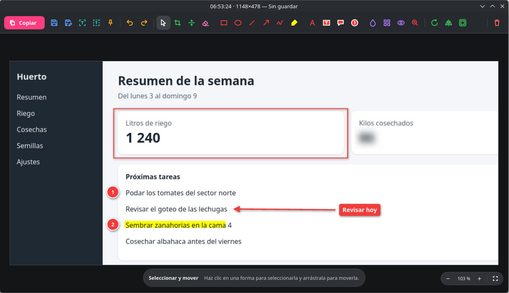

# ShareK

Capturas de pantalla, grabación y anotación. Captura una zona, una ventana o la pantalla completa, la anota en el editor y la copia o la guarda. También graba MP4 y GIF, hace capturas con desplazamiento, fija imágenes sobre la pantalla, mide con una regla, toma colores y extrae texto con OCR.

Tiene una versión para KDE Plasma 6, en `linux/`, y otra para la barra de menú de macOS, en `macos/`.



## Linux

### Requisitos

- KDE Plasma 6 en Wayland
- x86-64 con glibc 2.35 o superior
- GStreamer con los elementos `pipewiresrc`, `x264enc`, `mp4mux`, `fdkaacenc` y `pulsesrc`, para grabar MP4
- `ffmpeg` y `ffprobe`, para las miniaturas y portadas de los videos
- `onnxruntime`, para el OCR
- La fuente Noto Sans
- CachyOS, la única distribución probada

### Instalar

```bash
curl -LO https://github.com/swtnicolas/sharek/releases/latest/download/sharek-install.sh
bash sharek-install.sh
```

El instalador copia los programas en `~/.local/bin`, descarga los modelos de OCR y arranca ShareK en la bandeja del sistema. La primera vez, KDE pide aprobar los atajos de teclado globales: acéptalo para que funcionen.

### Atajos

| Atajo | Acción |
|---|---|
| Impr | Capturar región |
| Mayús+Impr | Capturar pantalla completa |
| Meta+Impr | Capturar ventana activa |
| Ctrl+Mayús+6 | Grabar video (MP4) |
| Ctrl+Mayús+7 | Grabar GIF |
| Ctrl+Mayús+8 | Captura con desplazamiento |
| Ctrl+Mayús+9 | Fijar región en pantalla |
| Ctrl+Mayús+0 | Capturar texto (OCR) |
| Ctrl+Mayús+1 | Selector de color |
| Ctrl+Mayús+2 | Regla |
| Ctrl+Mayús+H | Historial |

Se cambian en Configuración del sistema › Atajos, y el menú de la bandeja muestra los que estén configurados.

### Actualizar

```bash
curl -LO https://github.com/swtnicolas/sharek/releases/latest/download/sharek-install.sh
bash sharek-install.sh
```

Los ajustes, los atajos y el historial se conservan.

### Desinstalar

```bash
bash sharek-install.sh --uninstall
```

Los ajustes, el historial y los modelos de OCR quedan en `~/.config/sharek` y `~/.local/share/sharek`; para borrarlos también:

```bash
rm -r ~/.config/sharek ~/.local/share/sharek
```

Las capturas guardadas no se tocan.

### Instalar desde el código

```bash
bash linux/scripts/install.sh
```

Requiere Rust 1.99 o superior. `sh linux/scripts/test.sh` corre las pruebas y clippy, y `sh linux/scripts/package.sh` genera `linux/dist/sharek-install.sh`.

## macOS

No hay descarga para Mac: la app se compila en el propio equipo, porque macOS bloquea una copia descargada sin firma de Apple.

### Requisitos

- Mac con Apple Silicon
- macOS 27.2, la única versión probada
- Command Line Tools de Xcode (`xcode-select --install`)

### Instalar

```bash
git clone https://github.com/swtnicolas/sharek.git
bash sharek/macos/scripts/install.sh
```

Compila la app, la copia en `~/Applications/ShareK.app` y la abre; la primera vez queda configurada para abrirse al iniciar sesión. La primera captura pide el permiso de Grabación de pantalla, en Ajustes del Sistema › Privacidad y seguridad › Grabación de pantalla. La captura con desplazamiento automático usa además el permiso de Accesibilidad; sin él, la captura sigue en modo manual.

Los atajos de captura son ⇧⌘3, ⇧⌘4 y ⇧⌘5, y los demás usan ⌃⇧ con el mismo número o letra que en Linux. Para que ShareK reciba ⇧⌘3, ⇧⌘4 y ⇧⌘5, desactiva los de macOS en Ajustes del Sistema › Teclado › Atajos de teclado › Capturas de pantalla.

### Actualizar

```bash
git -C sharek pull
bash sharek/macos/scripts/install.sh
```

Los ajustes y el historial se conservan. Cada compilación lleva una firma nueva, así que macOS vuelve a pedir los permisos, salvo que el llavero tenga un certificado de firma de código llamado "Nico Local".

### Desinstalar

```bash
bash sharek/macos/scripts/uninstall.sh
```

Para borrar también los ajustes y el historial:

```bash
defaults delete local.sharek
rm -r ~/Library/Application\ Support/ShareK
```

El inicio de sesión se quita en Ajustes del Sistema › General › Ítems de inicio de sesión, y los permisos en Ajustes del Sistema › Privacidad y seguridad.
